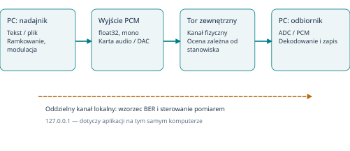
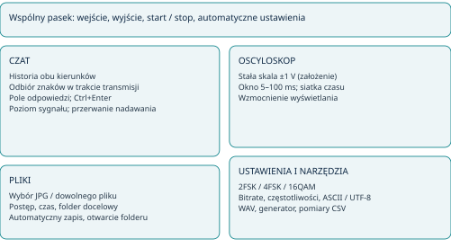
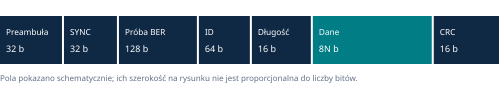
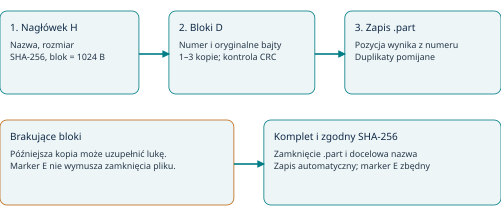

# LPTM — Laser Polarisation Modulation Transciever

Dokumentacja oprogramowania i wyników weryfikacji. 17.11.2026.

> **Jak czytać raport** Implementacja, testy programowe, historyczne CSV słabego kanału oraz nowsze wyniki zespołu po poprawie toru są opisane oddzielnie. Rozdziały 15–16 przedstawiają przedwzmacniacz 25 V/V i odebrane zdjęcia.


## 1. Osiągnięte rezultaty

Opracowano zestaw aplikacji PC do nadawania, odbioru, diagnostyki i oceny jakości transmisji cyfrowej. System obsługuje tekst, rozmowę dwukierunkową i pliki binarne, korzystając ze wspólnego modemu programowego i interfejsów audio. Zintegrowany Transceiver udostępnia te funkcje w jednym oknie, w układzie dwóch kolumn bez zakładek.

| Rezultat | Stan udokumentowany |
| --- | --- |
| Trzy aplikacje | Nadajnik, Odbiornik i zintegrowany Transceiver; wspólna implementacja modemu. |
| Trzy modulacje | 2FSK, 4FSK i własny wariant 16QAM z pilotem fazowo-amplitudowym. |
| Transfer danych | ASCII / UTF-8, pliki w numerowanych blokach, CRC ramki i SHA-256 całego pliku. |
| Diagnostyka i pomiary | Oscyloskop, poziom AC w dBFS, nagrywanie WAV, BER i zautomatyzowane plany CSV. |
| Weryfikacja | 48 testów programowych: OK. Osiem wybranych serii archiwalnych: 154 nadania. |

> **Najważniejszy wniosek** Powstała spójna, testowalna warstwa programowa transmisji i pomiarów. Po zastosowaniu przedwzmacniacza 25 V/V zespół uzyskał 5 kbit/s w 2FSK oraz sprawną transmisję zdjęć w 4FSK przy 2,5 kbit/s i raportowanym BER 0,5%.

Wcześniejsze serie 50-punktowe dotyczą kanału słabej jakości: rozpoznano w nich 28/50 i 27/50 ramek. Nie opisują one osiągów po poprawie jakości toru. Nowsze próby potwierdzają użyteczną transmisję 2FSK 10/20 kHz przy 5 kbit/s oraz 4FSK 5–10 kHz przy 2,5 kbit/s. Dwa ukończone obrazy z TRANSMISJA są zgodne bajt w bajt ze źródłami. Trwają testy zwiększania szybkości 4FSK i 16QAM.

Źródło: kod i tests/; archiwalne CSV; uzupełnienie zespołu projektu; TRANSMISJA i porównanie SHA-256.


## 2. Zakres i identyfikacja opracowania

Dokument dotyczy projektu LPTM — Laser Polarisation Modulation Transciever i przedstawia stan jego oprogramowania na dzień 17.11.2026. Obejmuje wymagania funkcjonalne, architekturę, format danych, obsługę operatora, weryfikację oraz analizę zapisanych wyników pomiarowych. Jest samodzielnym załącznikiem technicznym do raportu końcowego; nie zastępuje części finansowej ani opisu organizacji grantu.

> **Granica systemu objętego dokumentacją** Analizowana implementacja wytwarza i odbiera próbki PCM przez interfejs audio. Nazwa projektu odnosi się do transceivera laserowego, jednak ten załącznik nie jest protokołem charakteryzacji źródła światła, detektora ani modulacji polaryzacji w torze optycznym.

### Trzy poziomy dowodów

| Poziom | Co potwierdza | Czego nie potwierdza |
| --- | --- | --- |
| Implementacja | Funkcje i ograniczenia zapisane w kodzie. | Niezawodności w dowolnych warunkach stanowiskowych. |
| Testy programowe | Zachowanie dla określonych scenariuszy, sztucznego PCM i interfejsów testowych. | Parametrów rzeczywistego toru audio lub optycznego. |
| Archiwum pomiarowe | Wynik konkretnych nadań zapisanych w CSV i metadanych. | Powtarzalności poza warunkami zarejestrowanej próby. |

Uzupełnienie zespołu opisuje nowszy etap stanowiskowy: zastosowanie przedwzmacniacza 25 V/V, uzyskane szybkości i raportowany BER. Parametry te zachowano jako oddzielny opis prób, a zgodność odebranych fotografii sprawdzono bezpośrednio na plikach. Nie dopisano tych wyników do wcześniejszych CSV.

### Identyfikowalność

Kod odniesienia: f32692ff91a7. Pełny identyfikator rewizji oraz SHA-256 plików źródłowych i wybranych danych zapisano w dane_i_proweniencja.json. Czasowe etykiety CSV pochodzą z UTC; datą opracowania dokumentu jest data lokalna Europe/Warsaw. Nie zmieniano danych źródłowych pomiarów.

Źródło: repozytorium, metadane JSON i manifest towarzyszący dokumentowi.


## 3. Architektura systemu



Rys. 1. Rozdzielenie toru danych PCM od lokalnych kanałów wzorca i sterowania.

| Warstwa | Moduły i odpowiedzialność |
| --- | --- |
| Interfejs operatora | transceiver.py, transmitter.py, receiver.py — wspólne kontrolery i widoki aplikacji. |
| Modem | modem.py — ramkowanie, CRC, generacja PCM, detekcja symboli i parser przyrostowy. |
| Strumienie audio | audio_runtime.py — odtwarzanie, przechwytywanie, kolejki, pomiary AC i zapis WAV. |
| Usługi danych | transfers.py, chat.py, text_encoding.py — pliki, historia rozmowy, transliteracja ASCII. |
| Automatyzacja | sweep.py, repeat_sweep.py, file_sweep.py — plany prób, logi i wznowienie pomiarów. |

Oddzielenie dostępu do urządzeń od modemu umożliwia weryfikację danych PCM bez uruchamiania fizycznego wejścia i wyjścia. Operacje audio i nagrywanie korzystają z wątków oraz kolejek; aktualizacja widżetów pozostaje po stronie pętli zdarzeń Tk. Współdzielenie obiektów ustawień w Transceiverze ogranicza rozbieżności między częścią nadającą i odbierającą.

Źródło: audio_runtime.py; transceiver.py; gui_common.py; ipc_control.py; ipc_reference.py.


## 4. Interfejs operatora



Rys. 2. Mapa funkcjonalna aktualnego interfejsu; schemat opracowany z kodu, nie zrzut ekranu.

Lewa kolumna skupia bieżącą pracę: rozmowę oraz nadawanie i odbieranie plików. Prawa kolumna zawiera oscyloskop i wspólne ustawienia transmisji. Generator, lokalne odtwarzanie audio, logowanie i pomiary CSV są dostępne w rozwijanym obszarze narzędzi dodatkowych, bez zmiany zakładek.

| Działanie | Zachowanie interfejsu |
| --- | --- |
| Wysłanie odpowiedzi | Pole czatu → Wyślij lub Ctrl+Enter; Enter dodaje nowy wiersz. |
| Zmiana ASCII / UTF-8 | Przy wyborze ASCII treść pola jest transliterowana; znaki bez odpowiednika stają się ?. |
| Odbiór pliku | Postęp bajtowy, stan kompletności, ścieżka docelowa i przycisk Otwórz folder. |
| Przerwanie | Osobne zatrzymanie nadawania i odbioru; niepełny transfer pozostaje w .part. |

Źródło: transceiver.py; Receiver._build_transceiver_view; Transmitter._build_transceiver_view; chat.py.


## 5. Modulacje i parametry transmisji

Parametr bitrate Rb wyrażany jest w bit/s. Liczba bitów przypadających na symbol wynosi k = log₂(M), a szybkość symbolowa Rs = Rb/k. Dla tej samej liczby bitów 4FSK i 16QAM wykorzystują odpowiednio dwa i cztery bity na symbol. Parametr baud w klasie konfiguracji przechowuje bitrate, a nie niezależną szybkość symbolową.

| Tryb | k / Rs | Sposób wyznaczania sygnału |
| --- | --- | --- |
| 2FSK | 1 / Rb | Dwie zadane częstotliwości, przypisane do 0 i 1. |
| 4FSK | 2 / Rb/2 | Cztery równomiernie rozłożone tony między fL i fH; symbole 00, 01, 10, 11. |
| 16QAM z pilotem | 4 / Rb/4 | Nośna (fL + fH)/2; pilot w pierwszej połowie symbolu, poziomy I/Q w drugiej. |

### Ograniczenia walidatora konfiguracji

Dla 2FSK wymagane jest |f1 − f0| ≥ Rb. Dla 4FSK odstęp sąsiednich tonów musi wynosić co najmniej Rs, co daje fH − fL ≥ 1,5 Rb. Dla 16QAM sprawdzane są fH − fL ≥ Rs oraz fL ≥ 2 Rs. To warunki dopuszczenia ustawień przez program, a nie dowód optymalnej ortogonalności lub odporności kanału.

Wariant 16QAM stosuje poziomy Gray: 00→−3, 01→−1, 10→+3, 11→+1. Pilot umożliwia oszacowanie fazy i wzmocnienia nośnej osobno dla symbolu. Jest to własny format aplikacji; nie deklaruje się zgodności z zewnętrznym standardem modemu QAM.

> **Przykład 4FSK** Dla fL = 4000 Hz, fH = 10000 Hz i Rb = 1234 bit/s tony wynoszą 4000, 6000, 8000 i 10000 Hz, a Rs = 617 symboli/s. Takie parametry występują w teście programowym z szumem.

Źródło: ModemConfig.validate, ModemConfig.tones, fsk_chunks, _qam_symbol; tests/test_modem.py.


## 6. Próbkowanie i synchronizacja

| Parametr | Wartość / znaczenie |
| --- | --- |
| Format PCM | Mono, float32; amplituda nadajnika w zakresie 0–1. |
| Próbkowanie fs | 48 000, 96 000 lub 192 000 próbek/s. |
| Górny limit tonu | min(48 000 Hz, fs/2 − 100 Hz): 23,9; 47,9 lub 48 kHz. |
| Bitrate | 5–10 000 bit/s; Transceiver domyślnie 500 bit/s, samodzielny modem 25 bit/s. |
| Blok audio | Typowo 2048 próbek; parser i dekoder zachowują stan między blokami. |
| Hipotezy czasu | Do ośmiu przesunięć fazy czasowej w obrębie symbolu. |

### Granice symboli bez narastającego dryftu

```text
n(j) = round(j · fs / Rs)
liczba próbek symbolu j = n(j+1) − n(j)
```

Zaokrąglane są skumulowane granice symboli, zamiast powtarzania jednej zaokrąglonej długości. Pozwala to obsługiwać niecałkowitą liczbę próbek na symbol, np. dla ułamkowego bitratu. W FSK zachowywana jest ciągłość fazy w ramce; na jej brzegach stosowane jest wygaszanie. Za ramką dodawany jest zapas ciszy o długości czterech symboli.

Detekcja FSK porównuje moce obliczone metodą Goertzela dla zadanych tonów. Dekoder przetwarza kilka hipotez granicy symbolu, a następnie wybiera kandydatów według poprawności CRC i błędów próby BER. Wariant QAM wykorzystuje dopasowanie składowych sinus/cosinus i odniesienie do pilota.

> **Znaczenie limitu 48 kHz** Ton 48 kHz wymaga w tej aplikacji próbkowania 192 kHz. Jest to możliwość generacji i dekodowania programowego; rzeczywiste pasmo zależy od użytego DAC, ADC i toru fizycznego.

Źródło: modem.py; audio_runtime.py; tests/test_modem.py.


## 7. Ramka warstwy transmisyjnej



Rys. 3. Wspólny format bitowy dla wiadomości, zapowiedzi konfiguracji i pakietów pliku.

| Pole | Rozmiar | Interpretacja |
| --- | --- | --- |
| Preambuła | 32 b | Naprzemiennie 1 i 0; wyszukiwanie początku ramki. |
| SYNC | 32 b | Stałe słowo 0xDDAA96F3. |
| Próba BER | 128 b | Znany wzorzec pozwalający ocenić odebrane bity bez lokalnego wzorca danych. |
| Identyfikator | 64 b | Osiem bajtów ID wiadomości lub transferu. |
| Długość | 16 b | Liczba bajtów danych; implementacja dopuszcza 1–2048 B. |
| Dane | 8N b | Treść komunikatu lub pakietu wyższego poziomu. |
| CRC | 16 b | CRC-16/CCITT-FALSE identyfikatora i danych. |

Wartości liczbowe i bity bajtów są wysyłane od najstarszego bitu. Stały narzut ramki wynosi 288 bitów, stąd Lramki = 288 + 8N. Pole długości i próba BER nie należą do zakresu obliczania CRC; z tego powodu poprawność parsowania tych pól ma osobne znaczenie dla synchronizacji i oceny błędów.

CRC wykorzystuje wielomian 0x1021 i stan początkowy 0xFFFF; test wektora 123456789 daje 0x29B1. Niepoprawna ramka tekstowa może być pokazana z oznaczeniem błędu. Jej dane nie są przyjmowane jako poprawny blok pliku.

Źródło: encode_payload, crc16, _BitParser; tests/test_modem.py.


## 8. Automatyczne ustawianie odbiornika

Przed normalnym wysłaniem danych nadajnik może nadać komunikat konfiguracyjny stałym trybem 2FSK: 1200/2200 Hz, 500 bit/s. Komunikat ma prefiks LPTN2 i bajt zerowy, a następnie JSON z konfiguracją oraz kodowaniem tekstu. Przesyłany jest w zwykłej ramce z CRC.

| Etap | Działanie |
| --- | --- |
| 1. Nasłuch | Odbiornik analizuje zapowiedzi równolegle do aktualnego trybu transmisji. |
| 2. Weryfikacja | Wymagane są poprawne CRC, format JSON i prawidłowe wartości ModemConfig. |
| 3. Przełączenie | Ustawiane są modulacja, tony, bitrate, próbkowanie i kodowanie. Przy zmianie fs otwierany jest nowy strumień audio. |
| 4. Przerwa ochronna | Nadajnik pozostawia około dwóch sekund przed przesłaniem właściwych danych. |
| 5. Dane | Odbiór wiadomości lub pakietów pliku w zapowiedzianym trybie. |

> **Zapowiedź nie jest uzgodnieniem z potwierdzeniem** Mechanizm jest jednokierunkowy: odbiornik nie wysyła ACK dla przyjętej konfiguracji. Utrata zapowiedzi może uniemożliwić odbiór następujących po niej danych. Odbiornik należy uruchomić przed nadawaniem.

Zapowiedź jest przesyłana przez audio i nie wymaga połączenia sieciowego między komputerami. Lokalne IPC pełni inną rolę: udostępnia wzorzec danych do BER i steruje zautomatyzowanym pomiarem. W procedurach pomiarowych wybierany jest ręczny, wspólny tryb 2FSK, aby nie mieszać zapowiedzi z właściwym oknem pomiarowym.

Zmiana częstotliwości próbkowania podczas odbioru zamyka aktywne nagranie WAV. Nowy strumień może zostać uruchomiony tylko wtedy, gdy urządzenie i jego sterownik obsługują zadane fs.

Źródło: transfers.py: bootstrap_config, settings_packet, announcement_chunks; Receiver._apply_settings.


## 9. Przesyłanie i zapis plików



Rys. 4. Odbiór odporny na duplikaty i opóźnioną kopię brakującego bloku.

Pakiet pliku ma prefiks LPTF2 i bajt zerowy. Pakiet H zawiera tekstowy nagłówek JSON: nazwę z rozszerzeniem, rozmiar, SHA-256 i block_bytes = 1024. Pakiet D zawiera typ, 32-bitowy numer bloku i maksymalnie 1024 oryginalne bajty. Pakiet E oznacza koniec nadawania. Dla całego pliku utrzymywany jest identyfikator transferu.

JPG i pozostałe obrazy nie są dekodowane jako UTF-8. Trafiają do osobnego panelu plików; również wybranie obrazu w dawnej ścieżce pliku tekstowego przekierowuje wysłanie do trybu binarnego. Rozwiązuje to błąd odczytu bajtów takich jak 0xFF jako znaków tekstowych.

Każdy poprawny blok jest zapisywany i opróżniany do pliku .part na pozycji wynikającej z jego numeru. Pominięcie jednego bloku nie usuwa późniejszych danych. Po zebraniu całości odbiornik odczytuje plik i weryfikuje SHA-256, po czym automatycznie nadaje mu docelową nazwę. Zgubienie pakietu E nie blokuje już ukończenia.

> **Integralność i ochrona istniejących danych** CRC-błędny blok jest pomijany. Domyślnie przesyłane są dwie kopie, z wyborem 1–3 w interfejsie. Istniejące pliki nie są nadpisywane; konflikt nazwy rozwiązywany jest przez dodanie ID transferu. Niekompletne dane pozostają jawnie oznaczone jako .part.

Źródło: transfers.py: file_packets i FileReceiver; Transmitter.send_file; tests/test_transfers.py.


## 10. Czat, kodowanie i integralność

Czat utrzymuje historię wiadomości wychodzących i przychodzących. Kolejne fragmenty tej samej wiadomości aktualizują jeden wpis. Identyfikatory własnych nadań pozwalają odfiltrować ich echo z historii rozmówcy. Własny komunikat otrzymuje stan Nadano po zakończeniu odtwarzania PCM, co nie jest potwierdzeniem dostarczenia na drugą stację.

| Mechanizm | Cel i ograniczenie |
| --- | --- |
| CRC-16 ramki | Wykrycie uszkodzeń ID i danych. Nie naprawia bitów i nie zabezpiecza kryptograficznie transmisji. |
| SHA-256 pliku | Końcowe porównanie pełnej zawartości z nagłówkiem; nie jest podpisem ani uwierzytelnieniem nadawcy. |
| Powtórzenia bloków | Stała redundancja 1–3 kopii; nie jest to selektywna retransmisja sterowana ACK/NACK. |
| ASCII | Czytelna transliteracja liter, np. Zażółć → Zazolc; nieobsługiwany znak → ?. |
| UTF-8 | Odbiór przyrostowy z oczekiwaniem na pełną sekwencję wielobajtowego znaku. |

### Zapis historii i wiadomości niepełnych

Rozmowę można wyeksportować do UTF-8. Odbiornik umożliwia również ręczny zapis bieżącej wiadomości z liczbą bajtów, BER i stanem CRC oraz ciągłe dopisywanie tekstu w trakcie odbioru. Niepełny lub CRC-błędny tekst pozostaje widoczny i oznaczony. Reguła ta służy diagnostyce; nie znosi wymagań integralności przy publikowaniu pliku binarnego.

Konwersja Unicode do ASCII jest celowo nieodwracalna. Dotyczy pola wiadomości i tekstu przed nadaniem; nigdy nie jest stosowana do zawartości zdjęcia lub innego pliku binarnego.

Źródło: chat.py; text_encoding.py; Receiver._show_progress i _log_progress; tests/test_chat.py.


## 11. Oscyloskop i pomiary sygnału

| Wskaźnik | Znaczenie |
| --- | --- |
| Oś napięcia | Stała skala −1…+1 V, 0,5 V na działkę; umowne przeliczenie PCM ±1 ↔ ±1 V. |
| Oś czasu | Okna 5, 10, 20, 50 lub 100 ms, obliczane z aktualnej częstotliwości próbkowania. |
| Przebieg | Surowe próbki przechwytywania, bez normalizacji amplitudy; przy redukcji do pikseli zachowywane są ekstrema. |
| Wzmocnienie wykresu | 0–60 dB, wyłącznie prezentacja; przekroczenia zakresu ±1 V są oznaczane. |
| Miernik AC | Szczyt i RMS w dBFS po filtracji składowej wolnozmiennej i odjęciu średniej. |
| Nagranie WAV | Mono float WAV z niezmienionych próbek, w aktualnym fs; osobny wątek zapisu. |

```text
G = 10^(g_dB / 20)
RMS_AC = sqrt(mean((x − mean(x))²))
L_RMS = 20 · log10(RMS_AC) [dBFS]
```

> **Skala V jest założeniem wizualizacji** Bez kalibracji karty i zewnętrznego toru odczyt ±1 V nie jest pomiarem napięcia na rzeczywistych zaciskach. dBFS jest poziomem względem pełnej skali cyfrowej, a procent amplitudy nadajnika nie jest procentem mocy optycznej.

Kalibracja stanowiskowa powinna oddzielnie wyznaczyć przeliczenie kodu PCM na napięcie, liniowość i pasmo dla zastosowanego fs. Zmiany wzmocnienia wyświetlania nie zmieniają PCM podawanego do dekodera ani danych rejestrowanych w WAV.

Źródło: scope.py; audio_runtime.py: ac_metrics, HighPass, WaveRecorder; tests/test_audio_metrics.py.


## 12. Metodyka pomiarów BER

Plan bazowy obejmuje 50 dopuszczalnych kombinacji częstotliwości i bitratu. Pary tonów powstają z kolejnych punktów szeregu częstotliwości, a bitrate jest ułamkiem różnicy tonów: 0,25; 0,5 lub 0,75. Po odrzuceniu punktów przekraczających 23,9 kHz i 10 000 bit/s skrypt wykonuje zaplanowane nadania. Metadane zapisują wiadomość, jej rozmiar i SHA-256, amplitudę oraz indeksy urządzeń.

| Miara | Definicja i zakres |
| --- | --- |
| BER wzorca | Błędy w znanej, 128-bitowej próbie ramki / liczba porównanych bitów tej próby. |
| BER danych | Porównanie odebranych i oczekiwanych bajtów lokalnego wzorca; XOR bitów plus kara za różnicę długości. |
| Rozpoznanie ramki | Status inny niż no_frame; nie oznacza automatycznie poprawnego CRC ani zgodnego ID. |
| Ocena no_frame = 100% | Umowna kara w podsumowaniu skuteczności, nie zmierzony odsetek błędnych bitów. |
| Poziom sygnału | RMS AC w dBFS z okna próby; niezależny od wysokości wykresu oscyloskopu. |

Funkcja porównania danych zlicza błędy w części wspólnej i osiem błędów za każdy brakujący lub nadmiarowy bajt. Mianownik ma długość dłuższego komunikatu. Przy uszkodzonym polu długości może więc różnić się między próbami. W raporcie podano również BER ważony: sumę błędów podzieloną przez sumę rzeczywiście porównanych bitów odebranych ramek.

> **Wznawianie nie oznacza nowego pomiaru starego punktu** Log surowy, metadane i coverage pozwalają odtworzyć liczbę nadań i rozpoznanych ramek. Punkty niezmierzone pozostają puste. Porównanie serii wymaga zgodności wiadomości, urządzeń, amplitudy i warunków toru.

Źródło: sweep.py; repeat_sweep.aggregate; file_sweep.py; compare_payload_bits; CSV raw i metadata JSON.


## 13. Serie 50-punktowe: słaby kanał

Rys. 5. Kanał słabej jakości: statusy dwóch historycznych serii. Każdy słupek obejmuje 50 ustawień. Wykres nie przedstawia osiągów po zastosowaniu przedwzmacniacza.

| Wskaźnik | Wiadomość 41 B | Wiadomość 128 B |
| --- | --- | --- |
| Amplituda cyfrowa | 40% | 40% |
| Rozpoznane ramki | 28/50 (56%) | 27/50 (54%) |
| Poprawne CRC | 18/50 | 19/50 |
| Brak rozpoznanej ramki | 22/50 | 23/50 |
| Błędy / porównane bity | 1116 / 9184 | 2359 / 29696 |
| BER ważony odebranych | 12.152% | 7.944% |
| Średnia ocena z karą za brak | 50.805% | 47.911% |

W obu seriach słabego kanału niewykrycie ramki było istotnym składnikiem niepowodzeń. Bliskie udziały rozpoznanych ramek nie dowodzą równoważności obu długości wiadomości: na każdą kombinację przypadało jedno nadanie, a warunki nie tworzą kontrolowanej, powtarzanej próby porównawczej.

Źródło: measurements/ber_1x_raw.csv i ber_128B_1x_raw.csv; liczby przeliczone bezpośrednio z logów.


## 14. Serie dziewięciopunktowe: słaby kanał

Rys. 6. Historyczne wyniki słabego kanału, wiadomość 128 B, amplituda 80%. Turkus: ok; bordowy: id_mismatch; bursztynowy: bad_crc; szary: no_frame. Liczby oznaczają BER danych [%]; brak nie jest wartością liczbową BER.

| Seria | Rozpoznane | CRC OK | Bez błędów danych | Brak ramki |
| --- | --- | --- | --- | --- |
| 1 | 6 | 5 | 5 | 3 |
| 2 | 4 | 3 | 3 | 5 |
| 3 | 4 | 3 | 3 | 5 |
| 4 | 3 | 3 | 3 | 6 |
| 5 | 3 | 2 | 2 | 6 |
| 6 | 1 | 1 | 1 | 8 |

Zapisana liczba rozpoznanych ramek zmienia się od 6/9 w serii 1 do 1/9 w serii 6. W tych sześciu logach nie rozpoznano ramek dla trzech najwyższych badanych bitrate’ów: 1500, 3500 i 5000 bit/s. Nie jest to granica osiągów projektu: w nowszych próbach po poprawie toru osiągnięto 5 kbit/s w 2FSK i sprawną transmisję obrazów w 4FSK (rozdziały 15–16).

Źródło: measurements/ber_128B_pomiar_1_80procent_raw.csv … ber_128B_pomiar_6_80procent_raw.csv.


## 15. Poprawa toru i nowe wyniki

Po dołączeniu przedwzmacniacza o wzmocnieniu napięciowym 25 V/V (około 28 dB) zespół projektu odnotował poprawę warunków odbioru i zwiększenie osiąganej szybkości transmisji. W odróżnieniu od wcześniejszych wykresów dla kanału słabej jakości nowsze próby potwierdziły sprawną transmisję danych i fotografii przy parametrach zestawionych poniżej.

| Wariant próby | Konfiguracja | Uzyskany rezultat |
| --- | --- | --- |
| 2FSK | Tony 10 kHz i 20 kHz; bitrate 5 kbit/s. | Transmisja osiągnięta po dodaniu przedwzmacniacza 25 V/V. |
| 4FSK — zdjęcia | Dolny ton 5 kHz, górny 10 kHz; bitrate 2,5 kbit/s. | Sprawny transfer obrazów; raportowany BER 0,5%. Odebrane pliki zachowano w TRANSMISJA. |
| Dalsze testy | 4FSK oraz 16QAM przy zwiększanych szybkościach. | Badania trwają; wartości końcowe dla szybszych konfiguracji nie zostały jeszcze ustalone. |

### Znaczenie jakości kanału

Rezultaty po poprawie toru wskazują na istotny wpływ jakości kanału na użyteczną szybkość i powodzenie transferu. Wyników historycznych obarczonych licznymi no_frame nie należy przedstawiać jako granicy możliwości urządzenia. W korzystniejszych warunkach uzyskano 5 kbit/s w 2FSK oraz transmisję zdjęć w 4FSK przy 2,5 kbit/s.

> **BER kanału a integralność pliku** Raportowany BER 0,5% dotyczy próby transmisji, nie zawartości ukończonego JPEG. Poprawne kopie bloków przechodzą CRC, a plik jest publikowany po zgodnym SHA-256. Dwa odebrane obrazy są identyczne bajt w bajt z plikami źródłowymi.

Parametry nowych prób i wartość BER przekazał zespół projektu. Są one dokumentowane odrębnie od historycznych logów CSV; szczegółowy licznik błędów i rozróżnienie BER wzorca / BER danych nie zostały podane w tym uzupełnieniu. Zgodność plików sprawdzono niezależnie na dostępnych artefaktach.

Źródło: uzupełnienie zespołu projektu z 17.11.2026; wyniki_przedwzmacniacz.json; TRANSMISJA.


## 16. Potwierdzenie transmisji zdjęć

W katalogu TRANSMISJA zachowano dwa ukończone obrazy JPEG. Poniżej przedstawiono ich reprodukcje i kontrolę zgodności z plikami źródłowymi o tych samych nazwach w katalogu projektu. Są to materiały wskazane przez zespół jako rezultat sprawnej transmisji zdjęć.

Rys. 7. Reprodukcje ukończonych plików z TRANSMISJA. Obrazy nie są symulacją transmisji.

| Plik odebrany | Rozmiar | Wymiary | Zgodność ze źródłem |
| --- | --- | --- | --- |
| karmelini.jpg | 3878 B | 320 × 240 px | Identyczne bajty; SHA-256 zgodny |
| Bez tytułu.jpg | 1241 B | 62 × 77 px | Identyczne bajty; SHA-256 zgodny |

### Skróty SHA-256 odebranych plików

karmelini.jpg

```text
2f98189aec6b2554d7cba733ab15795369e7cb35900413d5b0618fc0f292fa3e
```


Bez tytułu.jpg

```text
aeab8e7441f0e689f7aadcf5b669f935dadd46790cd6d18a86d69a42c6334c66
```


Zgodność pełnych plików potwierdza bezbłędne odtworzenie tych dwóch obrazów. Nie jest ona utożsamiana z zerowym BER wszystkich prób kanału. Katalog i zapis pomocniczy obejmują również wcześniejsze próby niepełne lub błędne; nie stanowią jednej serii dla podanej wartości 0,5%.

Źródło: TRANSMISJA/*.jpg; odpowiadające pliki źródłowe; weryfikacja_TRANSMISJA.json; zapisTransmisji16_11.txt.


## 17. Interpretacja wyników i ich granice

### 1. Rozpoznanie, poprawność bitowa i integralność to różne zdarzenia

Ramka może zostać rozpoznana, ale zawierać błąd ID lub CRC. Dlatego w raporcie oddzielono liczbę rozpoznanych ramek, poprawne CRC, BER danych i brak ramki. Sama średnia kolumny ber_percent z pięciokolumnowego podsumowania miesza pomiar błędów z umowną karą za utratę ramki.

### 2. Wyższy bitrate w konfiguracji nie gwarantuje skutecznego łącza

Walidator sprawdza zakresy liczbowe i minimalne odstępy tonów. Nie mierzy pasma stanowiska, nieliniowości, nasycenia ani rzeczywistego odstępu sygnału od szumu. Dane archiwalne wykazują dużą liczbę no_frame w kanale słabej jakości. Wyniki po zastosowaniu przedwzmacniacza pokazują sprawną pracę w lepszych warunkach: 2FSK 5 kbit/s oraz transfer zdjęć 4FSK 2,5 kbit/s. Udany test syntetyczny 10 000 bit/s potwierdza wybrany scenariusz obliczeniowy, nie użytkową szybkość wszystkich konfiguracji.

### 3. Nie należy przypisywać zmian między seriami jednej przyczynie

Metadane określają wiadomość, poziom cyfrowy i indeksy urządzeń. Nie zawierają kompletnej charakterystyki geometrii, toru optycznego, temperatury ani wszystkich ustawień zewnętrznych. Zmienności między sześcioma seriami nie można więc bezpośrednio przypisać jednemu parametrowi. Nowe wyniki po wprowadzeniu przedwzmacniacza są odrębnym etapem prób zespołu.

### 4. Kierunek dalszej walidacji

Dla wybranego stanowiska należy wykonać powtarzane serie przy stałej geometrii i wiadomości, rejestrować liczbę utraconych ramek osobno od BER oraz mierzyć czas i skuteczność całego transferu pliku. Dalsze próby szybszych konfiguracji 4FSK i 16QAM są obecnie prowadzone; ich wyniki należy uzupełniać z zachowaniem tej samej metodyki.

> **Wynik naukowo użyteczny** Archiwum pokazuje obszary poprawnego działania i niepowodzeń oraz pozwala wskazać następne eksperymenty. Osiągi w dobrym kanale opisują nowsze próby, a zgodne pliki JPEG potwierdzają praktyczną skuteczność transferu. Nie należy mieszać obu etapów w jedną średnią.

Źródło: logi surowe, metadane i ograniczenia implementacji opisane w rozdziałach 5–8.


## 18. Weryfikacja oprogramowania

> **Wynik: 48 testów — OK** Uruchomiono pełne odkrywanie unittest. Czas wykonania: 37.970 s. Kod zakończenia: 0. Zapis weryfikacji: testy_weryfikacja.json.

| Obszar | Scenariusze kontrolowane |
| --- | --- |
| Modem i CRC | Szum, nieznany początek rejestracji, fragmentacja PCM, ułamkowe granice symboli, uszkodzony payload i wektor CRC. |
| Nowe tryby | 4FSK i 16QAM przy 48/192 kHz, zmienionym wzmocnieniu, szumie i przesunięciu przechwytywania. |
| Pliki | JPG jako oryginalne bajty; brak kopii, powtórzony marker końca, brak markera końca i opóźniony brakujący blok. |
| Interfejs i czat | Brak zakładek w Transceiverze, wspólne ustawienia, oba kierunki czatu, odfiltrowanie własnego echa i ASCII. |
| Pomiary i IPC | Kolejka poleceń, lokalny wzorzec, plany CSV, wznowienie i semantyka no_frame. |
| Audio i pliki WAV | Składowa DC, RMS AC, filtr ze stanem oraz zgodność surowych próbek i częstotliwości zapisu. |

Test JPEG przeprowadza przesłanie pakietów przez generację i dekodowanie PCM, po czym porównuje odebrany plik z plikiem testowym. Test zapisu bez pakietu E potwierdza, że gotowy plik jest publikowany po komplecie bloków i zgodnym SHA-256. Osobny test sprawdza przyjęcie brakującego bloku po nadejściu E.

Część testów GUI zastępuje urządzenia i wywołania odtwarzania obiektami testowymi. Nie jest to nowy pomiar fizycznego łącza. Szczegółowy wykaz nazw testów znajduje się w katalogu tests/, a liczebności według plików w dane_i_proweniencja.json.

Źródło: tests/; testy_weryfikacja.json. Polecenie: python -m unittest discover -s tests -v.


## 19. Instalacja i uruchomienie

Kod wymaga Pythona 3.11 lub nowszego i środowiska graficznego Tk. Do dostępu audio wykorzystuje sounddevice, a do plików audio soundfile. Tworzenie wykresów wymaga dodatkowo matplotlib. Pakiety instalowane są w odrębnym środowisku wirtualnym.

### Windows — uruchomienie ze źródeł

```text
py -3 -m venv .venv
.venv\Scripts\python.exe -m pip install -r requirements.txt
.venv\Scripts\python.exe transceiver.py
```

### Samodzielne aplikacje i pakowanie

Analogicznie można uruchomić transmitter.py oraz receiver.py. Skrypt build_windows.bat tworzy Nadajnik.exe, Odbiornik.exe i Transceiver.exe za pomocą PyInstaller. Pliki aplikacji muszą być zamknięte podczas ich nadpisywania. Skrypt build_macos.sh przewiduje budowę aplikacji .app i opis dostępu do mikrofonu; nie zastępuje weryfikacji na docelowym komputerze Mac.

### Warunki stanowiskowe

Na obu stacjach należy wybrać właściwe wejście i wyjście. Urządzenia muszą obsługiwać żądaną częstotliwość próbkowania. Odbiornik uruchamia się przed nadajnikiem. Przy wspólnym komputerze monitorowanie mikrofonu może powodować sprzężenie; odsłuch nie jest warunkiem dekodowania.

> **Odtwarzalność wersji** Dla odtworzenia opisanego stanu należy użyć rewizji f32692ff91a7 i porównać SHA-256 plików z manifestem. Wymagania pakietów określają przedziały wersji, nie pełny lockfile środowiska.

Źródło: requirements.txt; requirements-experiment.txt; build_windows.bat; build_macos.sh; README.md.


## 20. Procedury odbioru i powtórzenia badań

| Krok | Kontrola i kryterium |
| --- | --- |
| 1. Identyfikacja stanowiska | Zapisać modele urządzeń, sterowniki, fs, tor fizyczny i geometrię. Sprawdzić poprawny wybór wejścia i wyjścia. |
| 2. Transmisja tekstu | Nadać krótki wzorzec, odnotować ID, bajty, CRC, BER i liczbę utraconych ramek; powtórzyć ustaloną liczbę prób. |
| 3. Transfer JPEG | Przesłać znany plik, porównać SHA-256 źródła i wyniku, zapisać czas oraz liczbę nadań i powtórzeń. |
| 4. Scenariusze zakłóceń | Oddzielnie sprawdzić utratę kopii, utratę końca, niekompletny transfer i zachowanie .part. |
| 5. Serie parametrów | Użyć planu CSV, stałego wzorca i amplitudy; zachować raw, summary, coverage oraz metadata. |
| 6. Ocena | Raportować skuteczność rozpoznania i ukończenia pliku obok BER. Nie utożsamiać no_frame z pomiarem 100% błędnych bitów. |

### Sprawdzenie planu bez generacji audio

```text
python sweep.py --dry-run
python file_sweep.py --plan-file measurements/plan_example.csv --dry-run
```

### Przykładowe uruchomienie badania

```text
python repeat_sweep.py --input-device 1 --output-device 0 --amplitude 0.4
python -m unittest discover -s tests -v
```

Przykładowe indeksy 0 i 1 muszą zostać zastąpione indeksami rzeczywistych urządzeń. Badanie automatyczne wymaga odpowiednich aplikacji i wolnych portów lokalnych. Wznowienie stosuje te same metadane; do nowej serii należy wybrać nową nazwę dziennika.

Źródło: sweep.py; repeat_sweep.py; file_sweep.py; measurements/plan_example.csv.


## 21. Ograniczenia i dalsze prace

| Ograniczenie | Znaczenie / kierunek rozwoju |
| --- | --- |
| Brak potwierdzeń i ARQ | Nadano nie oznacza dostarczenia. Rozszerzenie: ACK/NACK, selektywne ponawianie brakujących bloków i wznowienie transferu. |
| Dalsze przyspieszanie | Po uzyskaniu 2FSK 5 kbit/s i transferu 4FSK 2,5 kbit/s trwają próby szybszych 4FSK i 16QAM. Wymagają dalszej oceny odporności. |
| Brak FEC | Powtórzenia zwiększają redundancję, ale nie zastępują kodu korekcyjnego. Rozszerzenie: kodowanie kanałowe i przeplot. |
| Kalibracja | Skala V jest umowna; brak powiązania procentu PCM z mocą optyczną. Potrzebna procedura kalibracji toru. |
| Niepełne dane stanowiska | Archiwum nie dokumentuje wszystkich parametrów fizycznych. Potrzebna karta pomiarowa i powtarzane serie. |
| Brak uwierzytelnienia | CRC i SHA-256 sprawdzają spójność, a nie tożsamość nadawcy. Rozszerzenie zależy od przyszłego modelu użycia. |
| Przenośność sprzętowa | Dostępność 96/192 kHz, pasmo i sterowniki wymagają sprawdzenia na docelowej platformie. |

> **Priorytet rozwoju** Najpierw pomiar powtarzalnej skuteczności całego łącza i niezawodne odzyskiwanie brakujących bloków; następnie optymalizacja przepustowości. Podnoszenie samego bitratu nie rozwiązuje problemu integralności.

Rezultat obejmuje spójne oprogramowanie, jego testy oraz odnotowane po poprawie toru osiągi 2FSK i skuteczny transfer zdjęć 4FSK. Zgodność plików potwierdzono przez SHA-256. Obecnie rozwijane są wyższe szybkości 4FSK i 16QAM. Pełna charakterystyka transceivera wymaga nadal powiązania wyników z parametrami i pomiarami całego toru optycznego.

Źródło: ograniczenia wynikające z kodu, formatów protokołu i zakresu dostępnych danych pomiarowych.


## 22. Materiały źródłowe i pakiet raportowy

Dokument opracowano z repozytorium, danych archiwalnych, nowszego uzupełnienia zespołu i odebranych plików. Wyników po zastosowaniu przedwzmacniacza nie dopisywano do historycznych CSV. Poniższe grupy materiałów pozwalają prześledzić pochodzenie opisów, liczb i wykresów.

| Grupa | Pliki odniesienia |
| --- | --- |
| Implementacja i obsługa | README.md; modem.py; audio_runtime.py; transceiver.py; transmitter.py; receiver.py; scope.py; chat.py; text_encoding.py. |
| Protokoły i pomiary | transfers.py; ipc_control.py; ipc_reference.py; sweep.py; repeat_sweep.py; file_sweep.py; plot_results.py. |
| Pełne serie | measurements/ber_1x_raw.csv, ber_1x_metadata.json, ber_128B_1x_raw.csv, ber_128B_1x_metadata.json. |
| Serie porównawcze | measurements/ber_128B_pomiar_1_80procent_raw.csv … _6_80procent_raw.csv i odpowiadające metadata JSON. |
| Wyniki po poprawie toru | wyniki_przedwzmacniacz.json; weryfikacja_TRANSMISJA.json; TRANSMISJA/*.jpg i odpowiadające źródła; zapisTransmisji16_11.txt. |
| Weryfikacja | tests/test_*.py; tests/fixtures/photo.jpg; testy_weryfikacja.json. |
| Dodatki do PDF | LPTM_dokumentacja_zrodlo.md; dane_i_proweniencja.json; zestawienie_serii.csv; assets/ — wykresy PNG/PDF i diagramy SVG. |

### Regeneracja dokumentu

```text
python -m pip install -r docs/raport_grantowy/requirements-docs.txt
python docs/raport_grantowy/build_report.py
```

Identyfikator rewizji źródeł: f32692ff91a736f3d31d99b01519fb6b3dbcd4d7. Manifest zawiera rozmiary i pełne skróty SHA-256 wybranych plików. Wykresy są wyliczane z logów raw, a źródło Markdown powstaje z tych samych treści co PDF. Generator dokumentacji nie uruchamia pomiarów ani urządzeń audio.

Źródło: stan repozytorium z dnia opracowania, pełna lista i skróty w dane_i_proweniencja.json.
